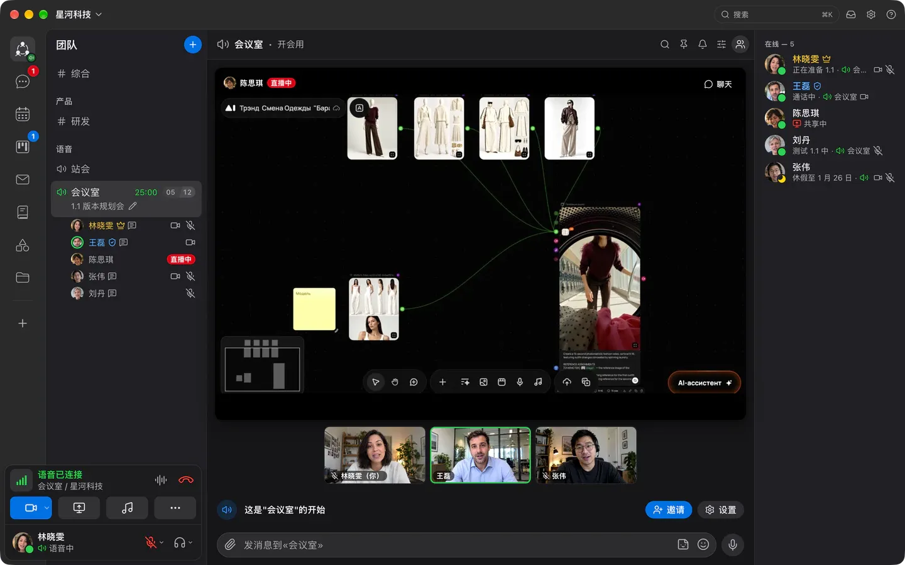
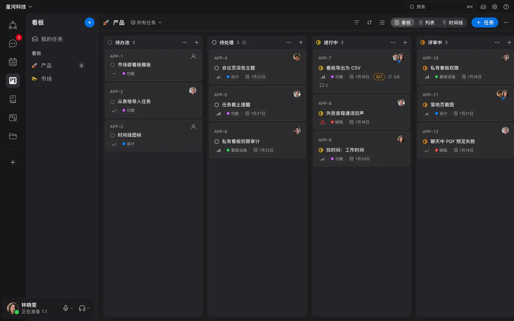
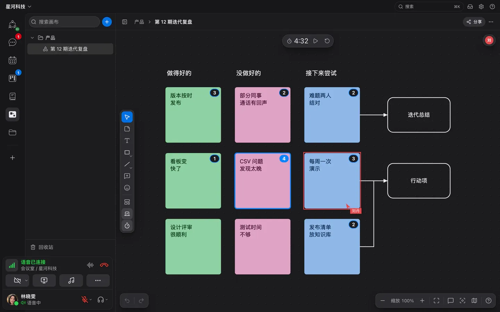
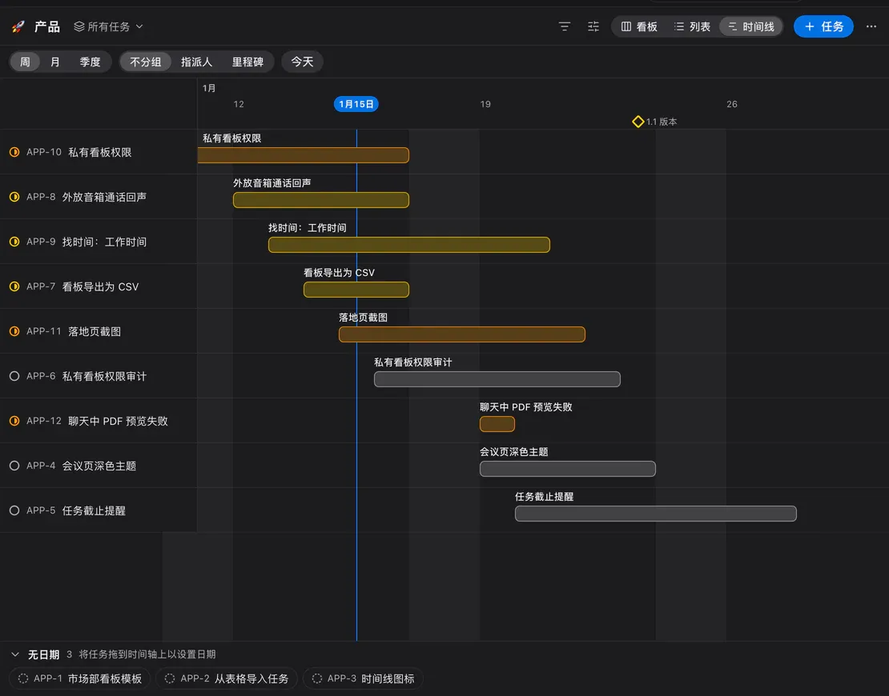

<p align="center"><a href="README.md">English</a> · <a href="README.ru.md">Русский</a> · <a href="README.es.md">Español</a> · <b>简体中文</b></p>

<p align="center">
  
</p>

<h1 align="center">Calab</h1>

<p align="center">
  团队的全部工作，一个窗口搞定：语音房间、聊天、会议、任务、维基、画布、网盘、邮件和电话，可用云端，也可部署在自己的服务器上。<br>
  <sub>以语音为核心的团队通讯工具。macOS · Windows · Linux · 网页 · 手机。</sub>
</p>

<p align="center">
  <a href="LICENSE"></a>
  <a href="https://github.com/itrcz/calab/actions/workflows/ci.yml"></a>
  
  
  
  <a href="https://calab.io/zh/"></a>
</p>

<p align="center">
  
</p>

---

## 这是什么

Calab 把团队的全部工作放进一个窗口：消息变成任务，任务有了会议，会议留下录音和转写，结果落到维基页面和画布上。一切相互链接。**语音**优先：进入房间就能立刻听到同事。Calab 可用云端，也可部署在自己的服务器上（一个 `docker compose`，内含 PostgreSQL 和 LiveKit）。

七个服务、七个标签页（即时通讯、视频通话、任务管理、维基、在线白板、网盘、邮件和电话系统），在这里只是左边的一列导航栏。客户端很轻量：在 MacBook Air M4 上，未通话时 CPU 占用 0.05%，语音中约 7%。

**平台：** macOS · Windows · Linux · 网页 · 手机（网页版可在手机浏览器中使用；iPhone 和 Android 应用即将推出）。

<table>
  <tr>
    <td width="50%"></td>
    <td width="50%"></td>
  </tr>
  <tr>
    <td width="50%"></td>
    <td width="50%"></td>
  </tr>
</table>

## 功能

### 总览，按官网分组

| 分组 | 包含内容 |
|---|---|
| 交流 | 语音房间与屏幕共享（可在画面上指示和绘画，降噪和回声消除），视频会议（最多 25 个画面），支持回复、表情回应和置顶的聊天，临时房间与访客，带转写的录制 |
| 工作 | 任务看板（看板、列表、时间线；表单、自动化、审批、历史），带查找空闲时间和 CalDAV 的日历，维基，画布（便签、形状、箭头、投票、计时器），网盘，邮件（桌面应用） |
| 有序而安静 | `⌘K` 全局搜索，按房间设置通知级别和任务触发器（可转发给你自己的机器人），角色与私密房间，固定在窗口中的网页应用 |
| 智能 | 智能任务（Business 方案起），会议摘要与转写，通过 MCP 把任意 LLM 客户端作为机器人接入。管理员在空间设置中一次性接入模型；未接入时 AI 不可用 |
| 电话 | 接入 SIP 服务商：语音菜单（IVR）、分组、员工和机器人的分机号、通话转接、通话录音保存到团队文件（Business 和 Enterprise） |
| 自托管与掌控 | 在自己的服务器上一个 `docker compose`，SSO / Active Directory / 角色，BSL 1.1 开放源码；[开发者文档](https://calab.io/en/docs/) |

### 🎙 语音与视频


- **语音房间**——一键加入；谁在说话直接显示在房间列表中；房间状态、计时和人数上限。
- **清晰的声音**——AEC3 回声消除和 RNNoise 降噪（不依赖外部服务），Opus + DTX；语音激活或任意按键的**按键说话**，后台也可用。
- **音乐人模式**——个人开关：关闭回声消除、降噪和自动增益，并将 Opus 切换为音乐配置（单声道 128 kbps / 立体声 192 kbps，FEC，无 DTX），现场演奏乐器或唱歌时声音不会被处理吃掉。需要佩戴耳机；其他人会在你的名字旁看到吉他图标。Team 及以上套餐。
- **屏幕共享**——AV1 或硬件 H.264，支持 simulcast：每位观看者获得与其网络匹配的画质；观看者可以在画面上指示和绘图。
- **摄像头**——背景虚化或替换图片（内置背景和工作区背景）。
- **一对一通话**——在私信中发起，支持铃声、摄像头和屏幕共享。
- **会议录音**——由服务器录制，GPTunneL 转写；房间聊天中会收到包含摘要、音频和完整转写的卡片。
- **音效板**、管理功能（服务器端静音、断开、拖动移动成员）、状态。
- **电话呼叫（SIP）**——接入你自己的 SIP 服务商，在语音房间中拨打座机或手机号码；被叫方作为参与者加入，所有人都能看到“拨号中 → 响铃中 → 通话中”。提供服务商设置、通话记录，以及默认无人拥有的“拨打电话”权限。仅限 Business 套餐和 Enterprise（[ADR-0046](docs/adr/0046-sip-telephony.md)）。
- **临时房间**——存在一小时或一天的房间，自带访客链接，也可同时在日历中创建会议：可替代 Zoom，到期自动消失（[ADR-0044](docs/adr/0044-temp-rooms.md)）。
- **视频会议画廊**——所有人以等大的画面分页显示（大屏最多 25 个），可在“画廊 | 发言人”之间切换；正在发言的人优先。

### 💬 聊天


- 像 Telegram 一样的气泡：回复、**表情回应**、一次转发到多个聊天、贴纸、语音消息、带预览的文件、置顶、已读标记。
- **提及**、按房间设置通知、支持词形变化的工作区搜索、`⌘K` 快速切换。
- 带归档的**私信**；网页版适配手机，可添加到主屏幕。
- **搜索**——`⌘K` 可搜索消息、任务及其评论、日历事件、文件、笔记和会议转写，支持词首匹配和容错拼写。
- **通知**——按房间设置级别；任务的每种事件都可单独关闭，你的任务通知还可转发给指定的机器人（例如转到 Telegram）。

### 📅 日历与会议

<table>
  <tr>
    <td width="50%"></td>
    <td width="50%"></td>
  </tr>
</table>

- 日视图中会议并排显示，会议卡片包含参会者和回复，带“前往”按钮的会议房间，支持重复和提醒。
- **邮件邀请**附带 `invite.ics`——会议会加入 Apple、Google、Outlook 或 Yandex 日历；外部参会者通过链接回复，并以访客身份加入。
- **查找时间**——同事的忙闲列、共同空闲时段，以及在所有人工作时间内最近的可选时间。
- **CalDAV**——连接 Yandex、iCloud、Fastmail 或 Nextcloud：你的忙碌时间会被计入，Calab 的会议也会自动出现在其中。

### ✅ 任务看板


<table>
  <tr>
    <td width="68%"></td>
    <td width="32%"></td>
  </tr>
</table>

- **看板、列表和时间线**（带里程碑和“今天”线的甘特图），Linear 风格，并支持其快捷键。
- 状态、优先级、标签、里程碑、截止日期；多名负责人（含主负责人）、子任务和关联。
- 像聊天一样的评论——表情回应、贴纸、语音消息——与变更历史穿插显示。
- 筛选、保存的视图、批量操作；**从任意消息创建任务**；任务链接在聊天中展开为卡片。

- **审批**——指定审批人以及所需的通过数（全部或 N/M）；任务获批之前无法在看板上继续流转（[ADR-0049](docs/adr/0049-task-approvals.md)）。
- **全屏任务**（桌面端），如同 Linear：`Esc` 返回看板，`↑`/`↓` 切换相邻任务。
- 任务内的**检查清单**（Team 及以上）：卡片上显示进度，可把条目转为子任务。
- 大任务内的**里程碑**，含截止日期和进度；在时间线上显示为菱形（[ADR-0063](docs/adr/0063-task-milestones.md)）。
- **自动化**——看板上的“当 → 如果 → 则”规则：更改状态、指派、向房间发消息等（Team 及以上，[ADR-0060](docs/adr/0060-board-automations.md)）。
- **收集表单**——公开链接或私有表单，用于创建任务，可设字段、默认状态和优先级（Team 每个看板 5 个，Business 20 个，[ADR-0064](docs/adr/0064-board-forms.md)）。
- **看板 Webhook**——为你的系统推送签名事件（Business）；每个看板可单独开关各项功能。
- **历史**——“评论”和“历史”两个标签：谁在何时改了什么，含前后值；重复编辑会合并。关注者、封闭看板上按卡片授权、给审批人的提醒。

### ✉️ 邮件

桌面应用中的邮件客户端：连接 Gmail、Yandex、Mail.ru 或 iCloud（需要应用专用密码），无需离开 Calab 即可收发邮件。邮件可连同附件以文本形式转发到聊天。邮件在本地运行——密码保存在系统钥匙串，服务器不参与；网页版和手机端没有邮件功能（[ADR-0088](docs/adr/0088-mail-client.md)）。

### 📚 维基


像 Notion 一样的页面与子页面：支持表格、清单、代码和图片的编辑器，实时协同编辑与光标，版本历史可恢复，按页面授权，公开只读链接。 页面之间可互相链接（`[[`），聊天中的页面链接会展开为卡片；目录树行和页面“⋯”使用同一个菜单：重命名、子页面、移动、权限、链接、版本、导出、回收站。

### 🗂️ 网盘


空间内的文件夹与文件：拖拽上传，平铺或列表，按文件夹授权（私有文件夹连管理员也看不到），公开文件链接，自动清理的回收站和清晰的空间用量。 用量条显示空间被什么占用：聊天、看板、维基和其他。

### 📝 笔记

最多 20 个私人书架，名称和表情由你决定——就像 Telegram 的“收藏夹”，但可以有多个。可以把消息和文件拖到书架上、转发、置顶和搜索。

### 🚪 访客与审批


访客链接直达房间——无需注册。开启审批后（按房间或按链接），访客会在此界面等待，直到组织者点击“放行”。 48 小时未登录的访客会被自动移除，并在成员列表中单独分组。离开的人以“前成员”身份保留在历史中：其消息和任务仍在，管理员可在单独的标签中查看。

### 🎂 成员

- **个人资料**含邮箱和电话（一键复制）、用于提及的唯一 `@昵称`、状态和生日。
- **生日**——聊天中的庆祝卡片和成员面板中的提示；**成就**“因某事”颁发，聊天中有卡片，资料中有一行展示（[ADR-0061](docs/adr/0061-achievements.md)）。

### 🧩 网页应用

管理员可在左侧栏工作区图标下固定网站快捷方式（Grafana、Wiki、CRM）。点击后网站会在 Calab 内全屏打开，通话不会中断；每个应用的登录状态各自独立保存，摄像头和麦克风仅在你允许后才可使用（[ADR-0050](docs/adr/0050-workspace-apps.md)）。

### 📱 手机

网页版适配手机并可安装到主屏幕：类似 Telegram 的房间列表，滑动手势（回复、标为已读），固定标签加“更多”，一眼看到谁在语音房间。iPhone 和 Android 应用（锁屏接听、推送）即将推出（[ADR-0067](docs/adr/0067-phone-shared-web-host.md)）。

### 🤖 机器人与 SDK

机器人是持有令牌的成员：与应用使用相同的 REST 和网关，通过角色授权。它可以读写聊天、响应 `/命令`、在语音房间中说话（LiveKit，Node / Python / Go），并按权限处理看板；事件通过 WebSocket 或带 HMAC 签名的 webhook 推送。机器人 API v2 还支持日历（会议、忙闲、查找时间）、成员资料、邀请、徽章、访客放行和会议录制，以及消息下方的按钮（[ADR-0051](docs/adr/0051-bot-api-v2.md)）。

```ts
import { Bot } from '@calaba/bot-sdk';

const bot = new Bot(process.env.BOT_TOKEN, { server: 'https://app.calab.io' });
bot.on('message', (m) => bot.reply(m, m.content));
await bot.start();
```

SDK：[`packages/bot-sdk`](packages/bot-sdk)；示例：[`examples/bots`](examples/bots)（echo、语音回声、TTS、Python）；文档：[docs/19-bot-api.en.md](docs/19-bot-api.en.md)（英文）· [俄文](docs/19-bot-api.md)。

机器人还可操作网盘和维基（文件夹、文件、页面）以及看板 Webhook。开发者文档——机器人作为集成 API、OAuth 2 / OIDC、SSO：**[calab.io/en/docs/](https://calab.io/en/docs/)**。

### 🔒 自托管与安全

- **随处可用**：自动按 UDP → ICE/TCP → TURN/UDP 443 → TURN/TLS 443 切换；只需一个公网 IP；已在 VPN 环境下测试。
- 媒体使用 DTLS-SRTP；API 使用 HTTPS/WSS、HSTS、严格的 CSP，网页版使用 `HttpOnly/SameSite=Strict` cookie，argon2id，刷新令牌轮换并检测重复使用，频率限制。暂不支持端到端加密：媒体经过你自己的媒体服务器。
- 所有权限（房间、看板、日历）都由服务器校验；LiveKit 授权与权限保持一致。
- **按功能划分的角色**——看板、成员、机器人、集成、日志、活动和录音各有独立权限；私有和封闭的房间与看板连管理员也看不到（[ADR-0048](docs/adr/0048-roles-v2.md)）。
- **Docker Compose** 容器加固、自动签发 Let’s Encrypt 证书、每日备份并验证恢复、Prometheus 指标；支持 PostgreSQL 17 或 18。

## 路线图

已计划，尚未推出：

- **语音 AI 助手**——房间中的语音 AI 助手（测试中）。
- **IVR**——电话呼叫（SIP）的语音菜单和内部分机号。
- **集成联系请求**——即将推出；暂不可用。

## 快速开始

### 自己的服务器

需要：一台有公网 IP 的 Linux 主机、Docker + Compose，以及为 `app`、`rtc`、`turn`（官网还需要 `@`）配置了 A 记录的域名。

```bash
git clone https://github.com/itrcz/calab.git && cd calab
cp infra/docker/.env.example infra/docker/.env   # DOMAIN 和密钥，见注释
infra/docker/deploy.sh                            # Caddy、LiveKit、API、Postgres、Valkey
```

端口：`80/443` TCP、`443/UDP`、`7881/TCP`、`7882/UDP`。第一个注册的用户成为服务器所有者；其他人通过邀请加入。完整说明、备份和加固见 [docs/06-deployment.md](docs/06-deployment.md)（俄文）。

### 应用

macOS、Windows 和 Linux 版本可在 [calab.io](https://calab.io/zh/#download) 下载，也可以在你的服务器 `https://app.<域名>/download/` 下载；网页版地址为 `https://app.<域名>`。各版本更新内容见 [CHANGELOG.md](CHANGELOG.md)（俄文；同样的内容也会发布到 [GitHub Releases](https://github.com/itrcz/calab/releases)）。

### 开发

```bash
corepack enable && pnpm install && make gen       # protobuf → Go + TS
pnpm infra:dev                                    # Postgres、Valkey、LiveKit --dev
cd apps/server && go run ./cmd/server serve       # API 监听 :3000
pnpm -F @calaba/desktop dev                       # Electron
```

检查：`make test`（Go + TS）、`make test-integration`、按界面运行视觉测试（`pnpm -F @calaba/desktop e2e:visual -g "<界面>"`）。架构文档（俄文）：[概览](docs/01-architecture.md) · [媒体](docs/02-media.md) · [网络](docs/03-network.md) · [数据模型与权限](docs/04-data-model.md) · [实时协议](docs/05-realtime-protocol.md) · [设计系统](docs/08-design.md) · [ADR](docs/adr/)。

## 价格

| | Free | Team | Business | Enterprise |
|---|---|---|---|---|
| 语音房间 | 最多 5 人 | 最多 15 人 | 最多 50 人 | 不限 |
| 工作区成员 | 最多 50 人 | 最多 100 人 | 最多 500 人 | 不限 |
| 音质 | 最高“普通” | 任意，最高“极佳” | 任意 | 任意 |
| 屏幕共享与摄像头 | 最高 720p / 15 fps | 画质不限 | 画质不限 | 画质不限 |
| 同时屏幕共享 | 1 | 2 | 5 | 不限 |
| 同时开启的摄像头 | 3 | 10 | 25 | 不限 |
| 文件 | 每个工作区 5 GB | 每个工作区 300 GB | 每个工作区 1 TB | 不限 |
| 机器人 | 1 | 5 | 20 | 不限 |
| 贴纸包 | 1 | 不限 | 不限 | 不限 |
| 任务看板 | 3 | 30 | 50 | 不限 |
| 维基页面 | 10 | 50 | 500 | 不限 |
| 画布 | 3 | 30 | 100 | 不限 |
| 日历 | ✓ | ✓ | ✓ | ✓ |
| CalDAV | — | ✓ | ✓ | ✓ |
| 电话呼叫（SIP） | — | — | ✓ | ✓ |
| On-prem（自有服务器） | — | — | — | ✓ |
| 支持 | — | 支持 | 优先支持 | ✓ |
| 价格 | 免费 | 按需询价（**support@calab.io**） | 按需询价（**support@calab.io**） | 非商业用途免费（BSL 1.1，保留“Powered by GPTunneL”）；商业许可按需询价 |

Free、Team 和 Business 是工作区的云端方案（[ADR-0024](docs/adr/0024-plans-and-limits.md)）；Enterprise 是部署在自有服务器上的 Calab（on-prem），没有任何限制。详情见 [calab.io/zh/#pricing](https://calab.io/zh/#pricing) 和 [COMMERCIAL-LICENSE.md](COMMERCIAL-LICENSE.md)。

**计费。** 工作区有余额，按席位按天扣费；可用银行卡或 SBP（俄罗斯）支付。付费套餐正逐个工作区开通；角色有独立的“查看 / 充值 / 管理”计费权限，套餐未激活时工作区仍可读取（[ADR-0080](docs/adr/0080-seat-billing.md)）。

## 许可证

**Business Source License 1.1**——[LICENSE](LICENSE)。

- 非商业用途（个人、非营利组织、教育、不超过 30 天的评估）**免费**，需在界面中保留“Powered by GPTunneL”并保留 [NOTICE](NOTICE)。
- 商业用途需获得 GPTunneL 许可：[COMMERCIAL-LICENSE.md](COMMERCIAL-LICENSE.md)，**support@calab.io**。
- 每个版本在发布四年后转为 Apache-2.0。

Calab 和 GPTunneL 的名称与标志是商标，见 [TRADEMARKS.md](TRADEMARKS.md)。

## 参与贡献与安全

欢迎通过 pull request 贡献代码（需签署 CLA）——[CONTRIBUTING.md](CONTRIBUTING.md)。请将安全漏洞私下报告至 **support@calab.io**，见 [SECURITY.md](SECURITY.md)。

<p align="center"><sub>© 2026 GPTunneL · Powered by <a href="https://gptunnel.ai">GPTunneL</a></sub></p>
